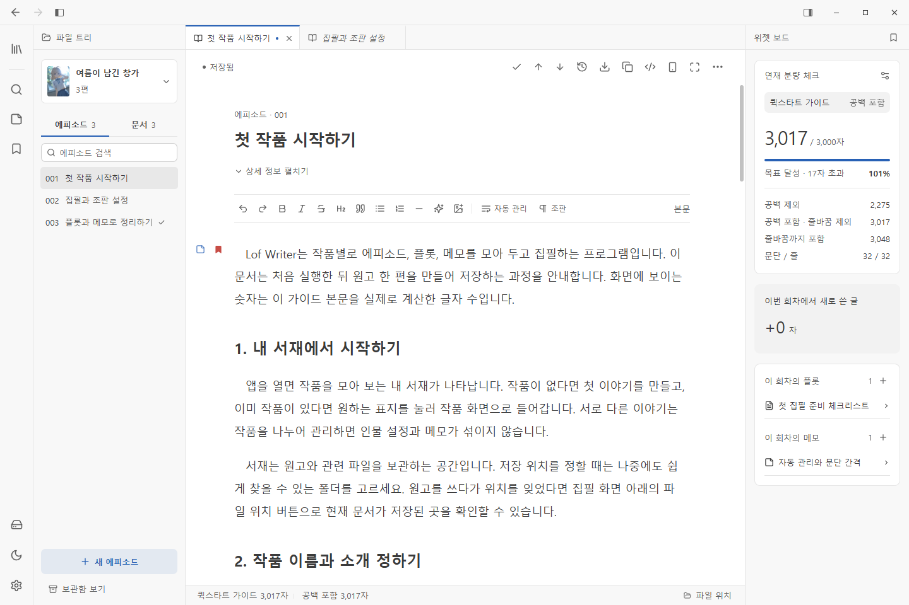
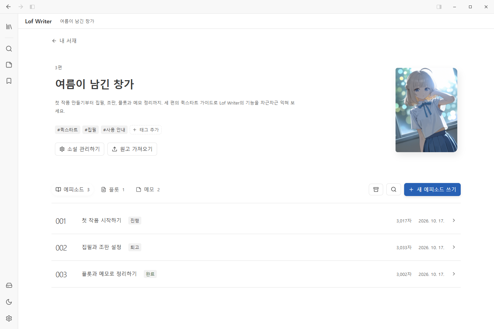
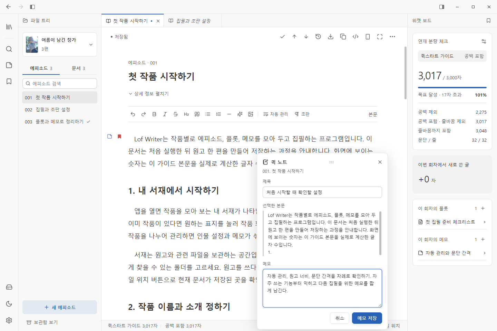
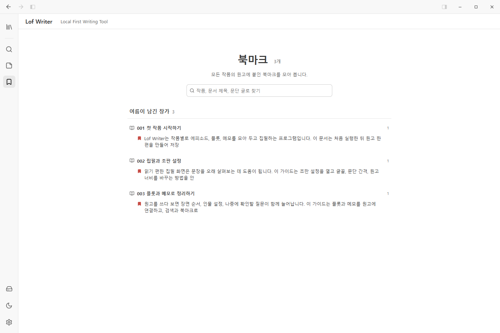
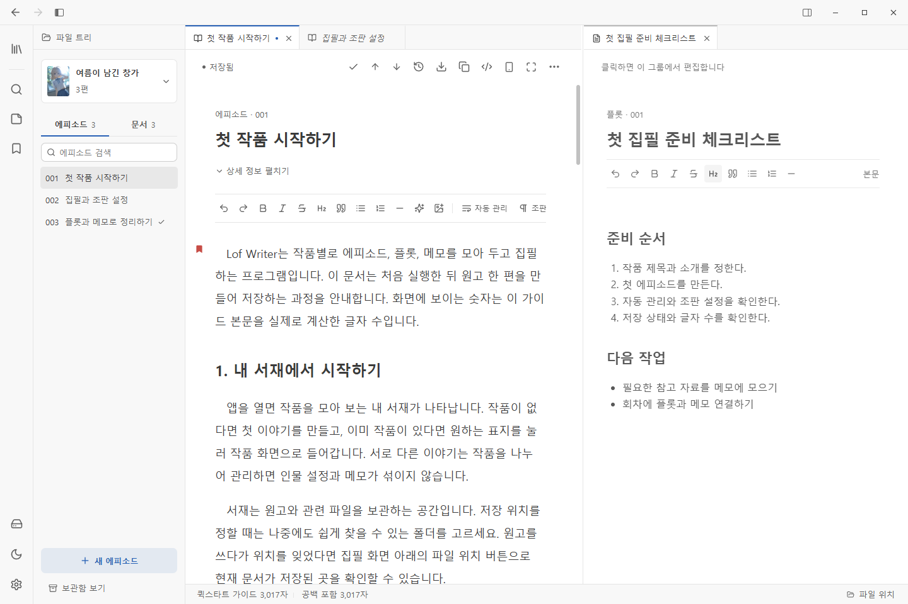
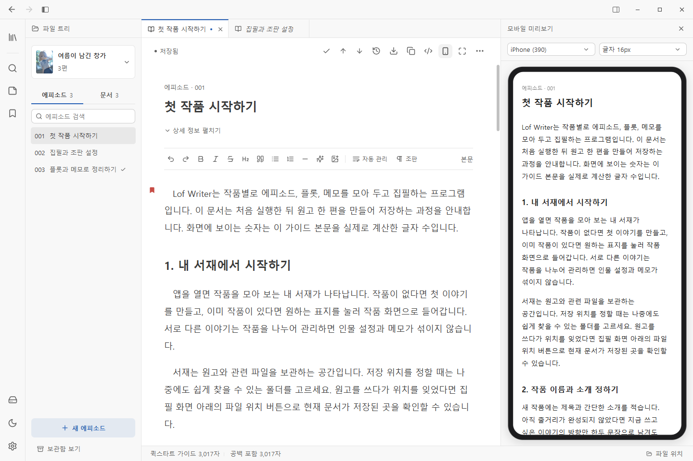
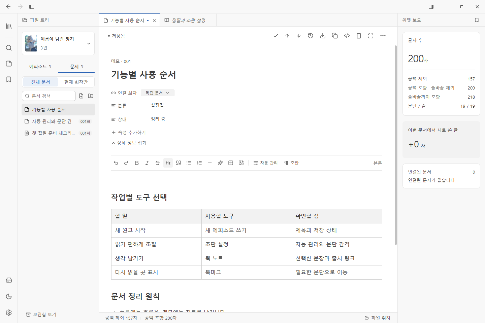

# Lof Writer

Windows와 Android에서 쓰는 로컬 파일 기반 소설 집필 앱입니다.

[다운로드 · 릴리즈 노트](https://github.com/loopix8000/lof-writer/releases)

## 화면으로 살펴보기

<!-- demo-snapshots:start -->

> 예시 이미지·원고는 생성형 AI로 제작했으며, 화면은 실제 앱에서 촬영했습니다.

### 집필 화면과 연결 문서 위젯

원고를 쓰면서 글자 수와 연결된 플롯·메모를 함께 확인합니다. 문단 여백의 북마크와 메모 표시로 필요한 위치에 돌아갈 수 있습니다.



### 회차와 집필 상태

표지와 작품 소개, 태그, 회차별 집필 상태를 한곳에서 관리합니다.



### 선택한 문장에서 퀵 노트 작성

원고에서 문장을 선택해 퀵 노트를 작성합니다. 제목과 생각을 적어 저장하면 원래 문장으로 돌아갈 수 있는 출처 링크가 남습니다.



### 모든 작품의 북마크 모아 보기

작품과 문서에 붙인 북마크를 한 화면에서 모아 보고, 원하는 문단으로 이동합니다.



### 원고와 플롯을 나란히 집필

원고와 플롯 등 두 문서를 나란히 열어 내용을 비교하고 집필합니다.



### 모바일 화면으로 원고 미리보기

집필 중인 원고를 모바일 화면의 폭과 글자 크기로 미리 살펴봅니다.



### 표와 문서 속성

플롯과 메모의 표로 설정과 자료를 정리하고, 문서에 사용자 속성을 붙입니다.



<!-- demo-snapshots:end -->

## 특징

- **계정 없이 사용**: 가입 없이 원고를 쓰고 관리합니다.
- **로컬 Markdown 저장**: 원고를 기기의 파일로 보관하며 다른 편집기로도 열 수 있습니다.
- **PC·모바일 지원**: Windows에서는 다중 탭·분할 편집, Android에서는 터치에 맞춘 집필 화면을 제공합니다.
- **선택적 동기화**: 기기끼리 연결하거나 외부 저장소를 지정해 원고를 동기화합니다.

## 주요 기능

| 기능 | 내용 |
| --- | --- |
| 작품·문서 관리 | 표지·소개·태그, 에피소드·플롯·메모, 폴더 정리, 회차 순서·집필 상태 변경, 완료 회차 편집 잠금, 보관함 |
| 집필 | 기본 서식, 장면 구분선, 이미지 삽입, 본문 주석, Markdown 원문 편집 |
| 입력 보조 | 따옴표·괄호 자동 닫기, 곡선 따옴표·말줄임표 치환, 사용자 대치어, 기호 일괄 교정 |
| 줄바꿈·복사 | 자동·수동 줄바꿈 관리, 문단 사이 빈 줄을 선택해 본문 텍스트 복사 |
| 북마크·퀵 노트 | 문단별 북마크, 모든 작품의 북마크 검색, 선택한 문장을 인용한 메모와 원고로 돌아가는 출처 링크 |
| 연결 문서·공용 메모 | 회차별 플롯·메모 연결과 위젯 보드, 여러 작품에서 함께 쓰는 공용 메모 |
| 표·사용자 속성 | 플롯·메모의 표 편집, 텍스트·숫자·체크·목록 속성, 속성 프리셋과 자주 쓰는 태그 |
| 조판·화면 | 글자 크기·줄 간격·들여쓰기·문단 여백, 사용자 글꼴, 밝은·어두운 테마, 집중 모드, PC의 모바일 미리보기 |
| 분량 | 플랫폼별 글자 수와 목표 분량, 공백 포함·제외 글자 수, 사용자 계산 규칙 |
| 검색 | 파일 이름으로 문서 열기, 서재 본문 검색, 현재 문서 안에서 검색 |
| 가져오기·내보내기 | Markdown·TXT·Muvel 백업(`.mvle`) 가져오기, 문서·작품·서재를 Markdown·TXT로 내보내기 |
| 변경 이력 | 본문·제목·속성 비교, 이전 버전 복원, 이력 개별 삭제, Git 이력 백업 |
| 외부 도구 | Claude·Codex용 MCP·로컬 API로 원고 조회·검색·수정, 연동용 스킬 다운로드 |
| 앱 업데이트 | 새 버전 확인·다운로드·설치, 플랫폼별 릴리즈 노트 조회 |
| Windows 트레이 | 창을 닫으면 트레이로 숨김, 트레이에서 다시 열기·앱 종료 |

조판은 에피소드와 플롯·메모에 따로 설정할 수 있습니다. 내장 글꼴 외에 `.ttf`, `.otf`, `.woff`, `.woff2` 파일을 추가할 수 있습니다.

## Android

- Android 7.0 이상, ARM64 기기용 APK를 제공합니다.
- 원고와 메모 편집, 북마크, 검색, 실시간·파일 동기화를 지원합니다.
- 집필 화면의 사이드바에서 문서를 길게 누르면 이름 변경·폴더 이동·보관·삭제 등을 사용할 수 있습니다.
- 기본 서재는 기기의 `Documents/Lof Library`입니다. 첫 실행 시 **모든 파일 접근** 권한이 필요하며, 이 폴더의 원고는 앱을 삭제해도 남습니다.

## 단축키

PC 기준입니다. `Ctrl+K`로 시작하는 단축키는 뒤의 키를 차례로 누릅니다.

| 동작 | 단축키 |
| --- | --- |
| 수동 저장 | `Ctrl+S` |
| 파일 이름으로 열기 | `Ctrl+P` |
| 서재 본문 검색 | `Ctrl+Shift+F` |
| 현재 문서 검색 | `Ctrl+F` |
| 다음/이전 검색 결과 | `F3` / `Shift+F3` |
| 파일 트리 열기/닫기 | `Ctrl+B` |
| 위젯 보드 펼치기/접기 | `Ctrl+Alt+B` |
| 탭 닫기 | `Ctrl+W` |
| 다음/이전 탭 | `Ctrl+Tab` / `Ctrl+Shift+Tab` |
| 탭 순서 변경 | `Ctrl+Shift+PageDown` / `Ctrl+Shift+PageUp` |
| 오른쪽으로 분할 | `Ctrl+\` |
| 아래로 분할 | `Ctrl+K` 다음 `Ctrl+\` |
| 편집 그룹 선택 | `Ctrl+1` ~ `Ctrl+4` |
| 인접 편집 그룹으로 이동 | `Ctrl+K` 다음 방향키 |
| 현재 탭을 다른 그룹으로 이동 | `Ctrl+Alt+←` / `Ctrl+Alt+→` |
| 모바일 미리보기 | `Ctrl+K` 다음 `V` |
| 집중 모드 | `F11` |
| 이름 바꾸기 (파일 트리) | `F2` |
| 보관 / 영구 삭제 (파일 트리) | `Delete` / `Shift+Delete` |

파일 트리에서는 `Ctrl`·`Shift`로 여러 항목을 선택해 함께 이동하거나 보관·삭제할 수 있습니다. 문서를 편집 화면의 원하는 방향으로 끌어 놓으면 분할해 엽니다.

## 실시간 동기화

Windows는 사이드바의 **구름 아이콘**, Android는 **설정 → 실시간 동기화**에서 엽니다. 한 장치에서 초대 코드를 만들고 다른 장치에서 **그룹 가입**을 선택해 입력합니다. Android에서는 QR 스캔으로도 가입할 수 있습니다. 초대 코드는 10분 동안 한 번만 사용할 수 있으며, 한 그룹에 최대 10대를 연결할 수 있습니다.

그룹에 가입하면 다른 장치를 자동으로 찾아 원고·작품 정보·이미지·첨부 파일을 주고받습니다. 그룹을 만든 장치가 꺼져 있어도 켜져 있는 장치끼리 동기화합니다. Lof Library를 상시 켜 두는 그룹 장치로 사용할 수도 있습니다.

연결은 암호화되며, 직접 연결이 어려우면 릴레이를 이용합니다. 그룹의 장치는 공유된 서재 파일을 읽고 수정할 수 있습니다. 장치를 제거하거나 그룹에서 나가도 이미 받은 파일은 각 기기에 남습니다.

PC·NAS용 개인 서재 동기화 서버 프로젝트는 [Lof Library Daemon](https://github.com/loopix8000/Lof-library-daemon)에서 확인할 수 있습니다.

## 파일 동기화

**설정 → 파일 동기화**에서 로컬·공유 폴더, WebDAV, FTP/FTPS 저장소를 연결합니다. 원고와 작품 정보, 이미지·첨부 파일을 폴더 구조 그대로 주고받습니다.

앱 시작·트레이 복귀 시와 설정한 주기에 변경을 확인합니다. 기본 주기는 5분이며 1분~1시간으로 조정할 수 있습니다. 수동 저장이나 **동기화** 버튼으로 바로 실행할 수도 있습니다. 백그라운드 동기화는 별도로 켜거나 끄고 주기를 정할 수 있습니다.

양쪽에서 같은 파일을 수정하면 연결별 충돌 처리 설정에 따라 최신본을 사용하거나 두 사본을 보존합니다. 열어 둔 원고에 외부 변경이 도착하면 **바뀐 내용 불러오기**로 반영하거나 **내 편집 사본 만들기**로 현재 내용을 보존합니다.

두 동기화 방식 모두 기기별 설정·변경 이력과 서재 밖에 지정한 공용 메모는 공유하지 않습니다. 동기화는 베타 기능이므로 중요한 원고는 별도로 백업하고, 연결할 기기는 모두 최신 버전을 사용해 주세요.

## 자동 저장과 변경 이력

**설정 → 보관 및 이력**에서 자동 저장 주기·최소 변경 글자 수와 이력 보관 기간·개수를 설정합니다. 입력 중에는 임시 원고를 저장하며, 복구할 내용이 있으면 서재에서 안내합니다.

변경 이력에서 이전 본문과 제목·상태·태그·사용자 속성을 현재 원고와 비교하고 복원할 수 있습니다. 수동 저장과 복원 기록은 따로 표시하며, 복원 전에 현재 원고를 보존합니다. 이력은 하나씩 삭제할 수 있고, 삭제한 이력은 앱에서 다시 복원할 수 없습니다.

이력은 각 기기의 로컬 Git에 보관합니다. 별도 Git 설치나 GitHub 계정은 필요하지 않습니다. **Git 이력 백업**은 이력을 보관하는 기능이므로 원고·첨부 파일까지 보존하려면 서재 폴더도 함께 백업해 주세요.

## PIN 잠금

**설정 → 앱 잠금**에서 4~12자리 숫자 PIN을 등록합니다. 앱 시작 시 PIN을 확인하며, Windows에서는 트레이에서 다시 열 때도 잠깁니다. 화면 잠금 기능으로, 원고 파일 암호화나 MCP·API 접근 제한은 제공하지 않습니다.

## 주의사항

- Windows 설치 파일은 코드 서명되어 있지 않습니다.
- HTML 등 일반 편집기에서 처리하기 어려운 문서는 원문 모드로 엽니다. 표의 직접 편집은 플롯·메모에서 지원합니다.
- 같은 원고를 여러 앱에서 동시에 수정하면 충돌할 수 있습니다.
- 글자 수는 실제 연재 플랫폼의 등록 화면과 차이가 있을 수 있습니다.

## 개발 정보

Tauri 2, Rust, React, TypeScript, Tiptap을 사용합니다. Windows 개발에는 Node.js 24 이상과 Rust, Tauri 2 빌드 환경이 필요합니다.

```powershell
npm ci
npm start
```

- 프론트엔드 검사·빌드: `npm run build`
- Rust 빌드 검사: `src-tauri`에서 `cargo check`
- Windows 폴더 배포본: `npm run package`
- Windows MSI: `npm run package:msi`
- Android APK: `npm run android:build` (Android SDK·NDK·JDK 필요)

배포와 업데이트 설정은 [RELEASING.md](RELEASING.md)를 참고하세요.

## 라이선스

[MIT License](LICENSE)

내장된 리디바탕·Pretendard·본고딕은 SIL Open Font License 1.1을 따릅니다. 고지와 전문은 [내장 글꼴 라이선스](FONT_LICENSES.md)에 있습니다. 앱의 **설정 → 앱 업데이트 → 오픈소스 라이선스**에서도 글꼴과 npm·Rust 라이브러리의 라이선스를 확인할 수 있습니다.
