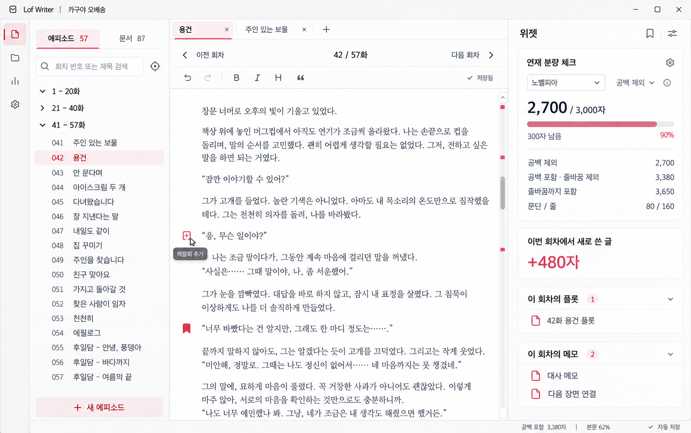

# 집필 화면 이미지 시안

> 정리일: 2026-10-17
> 생성형 이미지로 만든 검토용 시안이다. 본문·수치·연결 문서는 예시이며 일부 글자나 UI 상태는 실제 앱과 다를 수 있다.

이미지는 이 폴더에 복사해 프로젝트에서 보관한다. 원래 생성된 이미지도 그대로 보존했다.

## 최신 시안

### 04 — 본문 책갈피·우측 기능 아이콘

파일: [04-context-bookmark-icons.png](04-context-bookmark-icons.png)

- 책갈피 추가는 본문 문단 옆에서 제공한다.
- 우측 텍스트 탭과 빠른 실행 버튼 묶음을 없앤다.
- 우측 상단에 책갈피·조판 아이콘을 둔다.
- 회차별 플롯·메모를 포함한 기존 위젯을 유지한다.
- 좌측 회차 검색·구간 접기와 이전·다음 회차 이동을 유지한다.

## 이전 시안 이력

| 순서 | 이미지 | 검토 내용 | 현재 판단 |
| --- | --- | --- | --- |
| 01 | [회차 탐색과 책갈피 패널](01-episode-navigation.png) | 좌측 검색·구간 접기, 이전·다음 회차, 우측 책갈피·목차 | 좌측 방향은 참고. 우측이 기존 위젯을 충분히 반영하지 못해 수정 |
| 02 | [위젯·책갈피·조판 탭](02-widget-tabs.png) | 분량·집필량·연결 문서 위젯 복원, 우측 세 탭 | 탭 방식은 최신 아이콘 방식으로 대체 |
| 03 | [현재 회차 문서 필터와 빠른 실행](03-document-filter-actions.png) | 좌측 문서 트리의 현재 회차 필터, 우측 기능 버튼 | 빠른 실행 버튼 묶음과 연결 위젯 제거는 최신 안에 반영하지 않음 |

좌측의 `전체 문서 / 현재 회차만` 필터는 보조 기능으로 검토할 수 있다. 이를 우측의 플롯·메모 위젯을 제거하는 결정으로 해석하지 않는다.

## 문서와의 관계

- 최신 작업 목록: [UX TODO](../todo/UX.md)
- 전체 기획 자료: [문서 목록](../README.md)
- 시안은 배치와 흐름을 검토하는 참고 자료이며, 동작과 저장 방식은 TODO 및 설계 문서에서 정한다.
